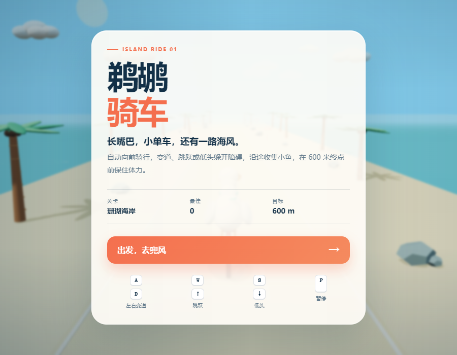

# 鹈鹕骑车 · Pelican Pedal Run

一只鹈鹕，一辆单车，一段海岛骑行。基于 Three.js 的 3D 网页小游戏，同时提供 Windows 便携可执行版本。



## 游戏内容

- 三车道自动前进，在 600 米终点前保住体力。
- 变道、跳跃、低头躲避木箱、木栏和高横杆。
- 收集小鱼、累计得分，并根据剩余体力与小鱼数量获得星级评价。
- 可收起的开始菜单、暂停、重新开始和返回首页。
- 稳定后视跟随与自由 3D 环视，支持拖动和缩放。
- 使用 Web Audio 实时生成音效，无需下载音频资源。
- 支持键盘、鼠标以及触屏按钮操作。

## 直接运行 Windows 版

进入 `release` 目录，双击：

```text
Pelican-Pedal-Run-1.0.0-portable.exe
```

这是便携程序，不需要安装，也不需要单独安装 Node.js。支持 Windows 10 / 11 64 位。

程序目前没有代码签名。首次启动时，Windows SmartScreen 可能提示“Windows 已保护你的电脑”，确认文件来源后可以选择“更多信息”→“仍要运行”。

## 操作说明

| 操作 | 按键 / 手势 |
| --- | --- |
| 左右变道 | `A` / `D` 或 `←` / `→` |
| 跳跃 | `W`、`↑` 或空格 |
| 低头 | 按住 `S` 或 `↓` |
| 暂停 / 继续 | `P` 或 `Esc` |
| 切换后视 / 环视 | `C` 或右上角“环视 / 后视”按钮 |
| 环视 | 在菜单或游戏中拖动画面 |
| 缩放 | 鼠标滚轮或双指捏合 |
| 开始 / 继续 | 点击界面按钮或按 `Enter` |

触屏设备可以使用屏幕底部的变道、低头和跳跃按钮。游戏默认从稳定后视开始；拖动画面会自动进入环视模式。

## 网页版运行

需要 Node.js 20.19+ 或 22.12+，以及 npm。

```bash
npm install
npm run dev
```

终端会显示本地访问地址，通常为 `http://localhost:5173`。

构建并预览生产版本：

```bash
npm run build
npm run preview
```

网页产物位于 `dist` 目录。

## 桌面版运行与打包

开发时直接构建并打开桌面窗口：

```bash
npm run desktop
```

打包 Windows x64 便携可执行文件：

```bash
npm run pack:win
```

打包成功后，可执行文件位于：

```text
release/Pelican-Pedal-Run-1.0.0-portable.exe
```

Electron 运行时会使用本机图形能力渲染 WebGL 场景；如果显卡驱动异常，可尝试更新显卡驱动。

## 项目结构

```text
pelican-bike/
├─ desktop/
│  └─ main.cjs          # Electron 桌面入口
├─ src/
│  ├─ game.js           # 游戏循环、玩法与相机
│  ├─ models.js         # 鹈鹕、单车和场景模型
│  ├─ main.js           # 页面状态与界面事件
│  ├─ audio.js          # Web Audio 音效
│  └─ style.css         # 界面与响应式样式
├─ dist/                # 网页生产构建产物
├─ release/             # Windows 可执行文件产物
├─ index.html
└─ package.json
```

## 技术栈

- Three.js：3D 场景、模型、动画与 WebGL 渲染
- Vite：网页开发与生产构建
- Electron：Windows 桌面运行环境
- electron-builder：Windows 便携程序打包

游戏不依赖后端服务；最高分仅保存在当前浏览器或 Electron 应用的本地存储中。
